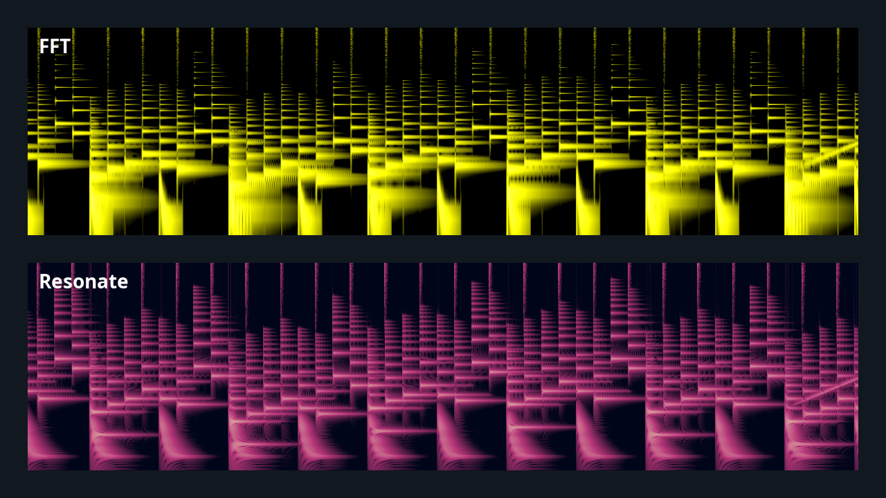
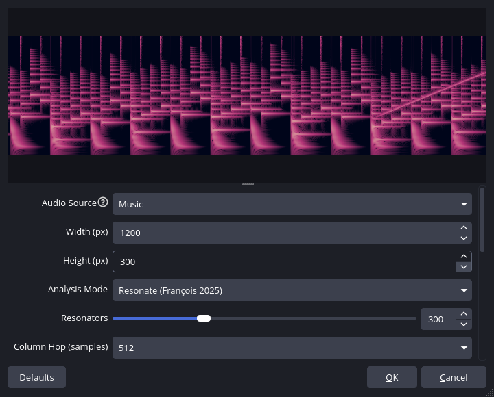

# Spectrogram

A rolling spectrogram source for [OBS Studio](https://obsproject.com/). Point it at any audio source, or at the whole output mix, and it draws a live, scrolling time/frequency picture of the sound, rendered on the GPU.



## Features

- **Two analysis modes**, selectable per source:
  - **FFT**: short-time Fourier transform with configurable size (256–8192), overlap and window function (Rectangular, Hann, Hamming, Blackman)
  - **Resonate**: a sample-by-sample resonator bank based on *"Resonate: Efficient Low Latency Spectral Analysis of Audio Signals"* by Alexandre R. J. François (ICMC 2025 Best Paper Award). No frame buffering and low latency; good at showing fast transients.
- **Any audio source, or the output mix**: the list shows only sources that actually produce audio (the same ones the Audio Mixer shows), plus *Output mix (Track 1)* for everything your stream hears
- **Logarithmic or linear frequency axis** with configurable min/max frequency
- **Configurable dB floor/ceiling and gain**
- **3-stop color palette** with alpha, for transparent overlays
- **Cheap to run**: one texture column per analysis frame, wraparound done by the GPU sampler, and no analysis at all while the source isn't visible anywhere

## Installation

Requires **OBS Studio 31 or newer**. Download the zip for your platform from the [latest release](https://github.com/vampirefrog/obs-spectrogram/releases/latest).

### Windows

Extract `obs-spectrogram-windows-x64-<version>.zip` into your OBS install folder, normally `C:\Program Files\obs-studio\`. It merges into the existing `obs-plugins` and `data` folders. Restart OBS.

### Linux

Extract `obs-spectrogram-linux-x86_64-<version>.zip` into your OBS plugins folder and restart OBS:

```bash
mkdir -p ~/.config/obs-studio/plugins
unzip obs-spectrogram-linux-x86_64-*.zip -d ~/.config/obs-studio/plugins/
```

This creates `~/.config/obs-studio/plugins/obs-spectrogram/`. The binary is built on Ubuntu 24.04, so it needs glibc 2.39 or newer.

### macOS

No prebuilt package yet; it should build from source (see below). Contributions welcome.

## Usage

1. In OBS, add a new source: **+** → **Spectrogram**
2. Pick the **Audio Source**:
   - one of your audio sources (mic, desktop audio, a media source, …), or
   - **Output mix (Track 1)** to visualize everything that goes to your stream/recording
3. Choose **FFT** or **Resonate** analysis and tune to taste (see the tips below)
4. Resize and position it like any other source. **Width** also sets how much history is visible: one pixel column per analysis frame.



### Tips

- **Transparent overlay**: set *Color: Low Power* to fully transparent, and the spectrogram floats over your scene.
- **Scroll speed** is set by the hop between columns: in FFT mode `FFT Size × (1 − Overlap)` samples, in Resonate mode *Column Hop*. At 48 kHz, FFT 2048 with 0.75 overlap gives about 94 columns per second.
- **Too dark or too bright?** Adjust *Floor (dB)* and *Gain (dB)* first.
- **Voice**: 80–8000 Hz on a log scale shows speech formants nicely. **Music**: 20–20000 Hz, log scale.
- Sources that are set up but produce no audio (a webcam with audio disabled, a window capture not capturing audio, a browser source without *Control audio via OBS*) are left out of the list. Enable their audio and they appear.

## Settings

| Setting | Description |
|---|---|
| Audio Source | The source to analyze, or *Output mix (Track 1)* |
| Width / Height | Size of the source in pixels. Width = number of columns of history. |
| Analysis Mode | FFT or Resonate |
| **FFT mode** | |
| FFT Size | DFT frame length (256 – 8192 samples). Larger = finer frequency detail, blurrier in time. |
| Overlap | Fraction of each frame reused by the next one (0 – 0.95) |
| Window Function | Rectangular, Hann, Hamming, Blackman |
| **Resonate mode** | |
| Resonators | Number of log-spaced resonator bands (2 – 1024) |
| Column Hop | Samples consumed per display column (64 – 2048) |
| Double Smoothing | A second smoothing pass (Eq. 8 of the paper) for a steadier picture |
| **Common** | |
| Min / Max Frequency | Frequency range shown, bottom to top (Hz) |
| Floor / Ceiling (dB) | dB range mapped onto the color palette |
| Gain (dB) | Added before color mapping |
| Logarithmic Frequency Scale | Log-spaced frequency axis (perceptually uniform) |
| Color: Low / Mid / High Power | Three color stops interpolated across the dB range |

## Troubleshooting

- **The spectrogram stays black**: check the audio source is producing sound (its meter moves in the Audio Mixer) and isn't muted, then lower *Floor (dB)* or raise *Gain (dB)*.
- **Changes don't seem to take effect after updating**: make sure only one copy is installed. Older builds may be in `/usr/lib/obs-plugins/`, `/usr/local/lib/obs-plugins/` or `~/.config/obs-studio/plugins/`. The OBS log (*Help → Log Files*) shows `[obs-spectrogram] version … loaded from …` for the copy actually in use, and `Source 'spectrogram_source' already exists! Duplicate library?` if there's more than one.

## Building from source

Requires the OBS Studio development files (libobs) and **CMake ≥ 3.16**.

```bash
cmake -B build -DCMAKE_BUILD_TYPE=Release
cmake --build build
```

### Linux

```bash
sudo apt-get install libobs-dev   # Debian/Ubuntu
cmake -B build -DCMAKE_BUILD_TYPE=Release
cmake --build build
```

Then either copy it into your per-user plugin folder:

```bash
dest=~/.config/obs-studio/plugins/obs-spectrogram
mkdir -p "$dest/bin/64bit" "$dest/data"
cp build/obs-spectrogram.so "$dest/bin/64bit/"
cp -r data/. "$dest/data/"
```

or install system-wide with `sudo cmake --install build` (to `<prefix>/lib/obs-plugins/` and `<prefix>/share/obs/obs-plugins/obs-spectrogram/`).

### Windows

Windows builds need libobs built from the OBS source with MSVC. [`.github/workflows/build.yml`](.github/workflows/build.yml) does exactly that and is the reference: it downloads `obs-deps` and the OBS source, builds the `libobs` and `obs-frontend-api` targets, then configures this plugin with `CMAKE_PREFIX_PATH` pointing at the result.

## Testing

`tests/soak/soak.py` is a soak test for crashes and leaks. It starts OBS headless (Xvfb) in a throwaway profile with the plugin from your build directory, and drives it through obs-websocket:

```bash
tests/soak/soak.py --build-dir build --minutes 10
```

It first runs functional checks: the audio source list, capturing a source, both analysis modes, the output mix, migration of old name-based settings, renaming the audio source and reloading the scene collection. It verifies each one by screenshotting the spectrogram. Then it randomly creates, reconfigures, hides and deletes spectrograms, switches audio sources (including missing ones), toggles studio mode and deletes and recreates the audio source. It fails on a crash, on any spectrogram that is never destroyed, on allocations leaked beyond OBS's own baseline (measured in a separate short run), or if memory is still growing in the second half of the run. `--seed` replays a run and `--ops` limits the random operations to a subset.

Memory is sampled at checkpoints with no spectrograms alive. Resizing between 64×64 and 4096×4096 frees and reallocates up to 128 MB at a time, which makes the allocator's high-water mark too noisy to judge, so memory growth only fails the run when `resize` is left out:

```bash
tests/soak/soak.py --ops create,remove,settings,audio,toggle,props,scene,studio,mute,recreate_media
```

For memory errors, build with AddressSanitizer and pass `--asan`:

```bash
cmake -B build-asan -DCMAKE_BUILD_TYPE=RelWithDebInfo \
      -DCMAKE_C_FLAGS="-fsanitize=address -fno-omit-frame-pointer" \
      -DCMAKE_MODULE_LINKER_FLAGS="-fsanitize=address"
cmake --build build-asan
tests/soak/soak.py --build-dir build-asan --asan
```

Needs Linux, OBS ≥ 29.1 with obs-websocket 5, Xvfb, xdotool, ffmpeg, and the Python packages `websockets` and `Pillow`.

## How the rendering works

The texture is a circular buffer of `width × height` pixels. Each analysis frame writes one column at the write head and advances it. The source is drawn as a single quad whose U coordinate runs from `write_col/W` to `write_col/W + 1.0`, and with `AddressU = Wrap` the GPU sampler handles the wraparound with no CPU-side shuffling.

Analysis runs once per frame in `video_tick`, not in `video_render`, which OBS calls once per view (preview, program, projectors). That keeps the scroll speed the same however many places show the source.

## Resonate mode

The Resonate algorithm maintains a bank of *N* independent complex resonators, each updated once per input sample:

```
P ← P · e^{−iω_k·Δt}          (rotate phasor)
R ← (1 − α_k)·R + α_k · x · P  (EWMA of demodulated signal)
```

where `α_k = 1 − e^{−Δt · f_k / log(1 + f_k)}` gives each resonator a time constant proportional to its period. Resonators are geometrically spaced between the configured frequency bounds. The magnitude `|R|` is read every *hop* input samples to produce one display column.

Unlike FFT, Resonate needs no frame buffering: every sample updates the whole bank, so a column reflects the signal right up to its last sample.

## License

GPL-2.0-or-later, see [LICENSE](LICENSE), the same license as OBS Studio.

The Resonate algorithm is described in Alexandre R. J. François, *"Resonate: Efficient Low Latency Spectral Analysis of Audio Signals"*, ICMC 2025. The paper is published under the [Creative Commons Attribution 3.0 Unported](https://creativecommons.org/licenses/by/3.0/) license; this plugin contains an independent implementation based on it.

## AI disclosure

The design of this plugin, and the choice of the Resonate algorithm, are mine. The implementation was written with [Claude](https://claude.ai) (Anthropic), working from that design: the analysis and rendering code, audio source handling, the soak test, the CI workflows and this README.
